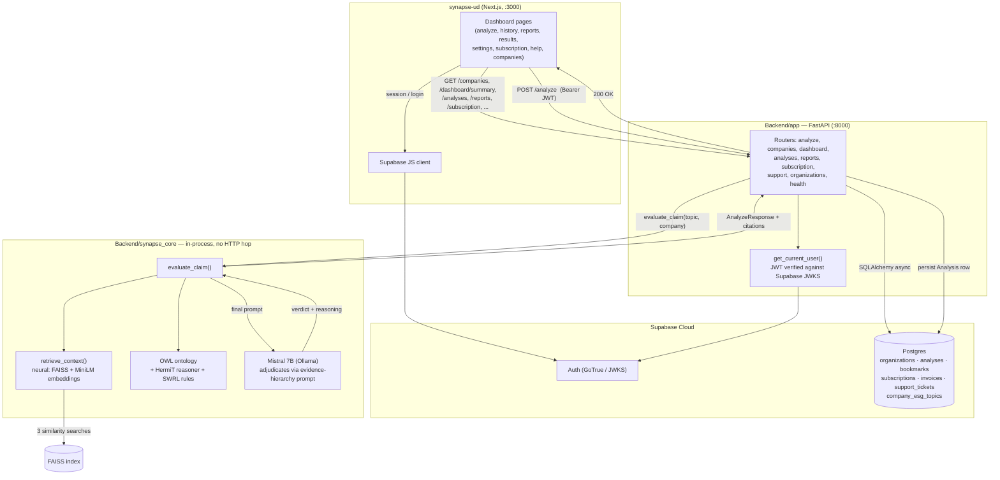

# SYNAPSE — Evidence-Grounded ESG Greenwashing Detection

SYNAPSE is an web application that evaluates a company's ESG (Environmental, Social, Governance) claims and flags likely **greenwashing** ; sustainability marketing that outpaces the evidence behind it. 

Research Paper: https://kaveeshafernando.vercel.app/synapse_.pdf

The project has two parts:

- **`Backend/`** : core contribution wrappe with a FastAPI service. 
- **`synapse-ud/`** : the Next.js frontend.

---

## Getting Started

**Prerequisites:** Python 3.11, Node 20+, a running [Ollama](https://ollama.com) instance with `mistral:7b` pulled, and a Supabase project (Postgres + Auth).

```bash
# 1. Backend
cd Backend
source venv/bin/activate       
python -m app.db.migrate        
uvicorn app.main:app --reload   

# 2. Frontend (separate shell)
cd synapse-ud
npm install
npm run dev                     
```

Environment files expected: `Backend/.env` (`SUPABASE_URL`,
`SUPABASE_SECRET_KEY`, `SUPABASE_DB_URL`, `CORS_ORIGINS`) and
`synapse-ud/.env.local` (`NEXT_PUBLIC_SUPABASE_URL`,
`NEXT_PUBLIC_SUPABASE_ANON_KEY`, `NEXT_PUBLIC_API_URL`).

---

## Architecture


---

## API Documentation

Base URL: `NEXT_PUBLIC_API_URL` (`http://localhost:8000` in dev). Auth is a
Supabase JWT as `Authorization: Bearer <token>`, verified in
`app/core/security.py`. 🔒 = auth required.

| Method | Endpoint | 🔒 | Request model | Response model |
|---|---|---|---|---|
| GET | `/health` | | — | `{"status": "ok"}` |
| POST | `/organizations` | | `OrganizationCreate {user_id, name, tin}` | `OrganizationOut` (201) |
| GET | `/organizations/me?user_id=` | | — | `OrganizationOut` |
| PATCH | `/organizations/{org_id}` | 🔒 | `OrganizationUpdate {name?}` | `OrganizationOut` |
| GET | `/organizations/{org_id}/notifications` | 🔒 | — | `NotificationPreferences` |
| PUT | `/organizations/{org_id}/notifications` | 🔒 | `NotificationPreferences` | `NotificationPreferences` |
| DELETE | `/organizations/{org_id}` | 🔒 | — | 204 (soft delete) |
| GET | `/companies` | | — | `list[CompanyOptions]` |
| POST | `/analyze` | 🔒 | `AnalyzeRequest {company, topic}` | `AnalyzeResponse` |
| GET | `/dashboard/summary` | 🔒 | — | `DashboardSummary` |
| GET | `/analyses?search=&company=&verdict=&sort=&page=&page_size=` | 🔒 | — | `AnalysisListResponse` |
| GET | `/analyses/by-query?company=&topic=` | 🔒 | — | `AnalysisDetail` |
| GET | `/analyses/{id}` | 🔒 | — | `AnalysisDetail` |
| DELETE | `/analyses/{id}` | 🔒 | — | 204 |
| POST | `/analyses/{id}/bookmark` | 🔒 | — | `{"bookmarked": true}` (201, idempotent) |
| DELETE | `/analyses/{id}/bookmark` | 🔒 | — | 204 |
| GET | `/analyses/{id}/download` | 🔒 | — | HTML file attachment |
| POST | `/analyses/{id}/share` | 🔒 | — | `ShareResponse {share_url, expires_at}` |
| GET | `/reports?search=` | 🔒 | — | `AnalysisListResponse` (bookmarked only) |
| GET | `/subscription` | 🔒 | — | `SubscriptionOut` |
| GET | `/subscription/invoices` | 🔒 | — | `list[InvoiceOut]` |
| GET | `/subscription/invoices/{id}/download` | 🔒 | — | HTML file attachment |
| POST | `/checkout` | 🔒 | `CheckoutRequest {plan}` | `CheckoutResponse` (201) |
| POST | `/subscription/upgrade` | 🔒 | `CheckoutRequest {plan}` | `CheckoutResponse` |
| POST | `/subscription/cancel` | 🔒 | — | `CheckoutResponse` |
| POST | `/support/tickets` | optional | `SupportTicketCreate {email, subject, message}` | `SupportTicketOut` (201) |

---

## Frontend — Pages & Features

All `/dashboard/*` pages are gated by `app/dashboard/layout.tsx`: redirects
to `/login` without a session, `/signup` without an org, `/pending` while
the org is unverified.

| URL | Live data | Features |
|---|---|---|
| `/` | static | Marketing homepage — hero, services, pricing, FAQ |
| `/login` | Supabase Auth | Email/password sign-in |
| `/signup` | Supabase Auth + `POST /organizations` | Account + org creation, TIN verification submission |
| `/pending` | static | Org-verification holding screen |
| `/checkout` | `POST /checkout` | Plan summary + billing form (simulated — no real charge), plan persisted server-side |
| `/dashboard` | `GET /dashboard/summary`, `/subscription` | Usage stat cards, monthly usage bar, recent-analyses table |
| `/dashboard/analyze` | `GET /companies`, `POST /analyze` | Company/topic pickers, live greenwashing verdict with full evidence citations |
| `/dashboard/companies` | `GET /companies` | Searchable directory of all tracked companies + their ESG topics |
| `/dashboard/history` | `GET /analyses` | Search, company/judgment filters, pagination, view/download/bookmark/delete per row |
| `/dashboard/reports` | `GET /reports` | Bookmarked analyses grid, unbookmark, download |
| `/dashboard/results` | `GET /analyses/by-query` | Full report: verdict, key findings, evidence-hierarchy reasoning, tabbed evidence panel, save/download/share |
| `/dashboard/settings` | `PATCH/DELETE /organizations`, notifications GET/PUT | Org name edit, notification toggles, danger-zone org deletion |
| `/dashboard/subscription` | `GET /subscription`, `/subscription/invoices` | Plan/usage/renewal, upgrade/cancel, billing history + invoice download |
| `/dashboard/help` | `POST /support/tickets` | FAQ accordion, support ticket submission |
